# MES Animated GitHub Assets

مجموعه‌ای از فایل‌های SVG متحرک با هویت بصری **معمار الکترونیک صنعت (MES)** برای استفاده در README مخزن‌ها و پروفایل GitHub.

این طرح‌ها با الهام از زبان بصری نئونی و مدارمحور پروژه [ElectroIoT](https://github.com/ElectroIoT/ElectroIoT) ساخته شده‌اند؛ آثار حاضر طراحی اختصاصی MES هستند و کپی فایل‌های آن پروژه نیستند.

## پیش‌نمایش فایل‌ها

### 1. سربرگ اصلی | MES Hero Banner

  

### 2. عنوان بخش | MES Section Header

  

### 3. کارت معرفی پروژه | MES Project Card

  

### 4. نوار وضعیت | MES Status Strip

  

### 5. بخش پایانی | MES Thank You Footer

  

## فایل‌ها و کاربردها

| فایل | کاربرد |
|---|---|
| [MES-Hero-Banner.svg](MES-Hero-Banner.svg) | سربرگ اصلی README یا پروفایل |
| [MES-Section-Header.svg](MES-Section-Header.svg) | معرفی بصری بخش‌های مهم |
| [MES-Project-Card.svg](MES-Project-Card.svg) | پنل معرفی پروژه |
| [MES-Status-Strip.svg](MES-Status-Strip.svg) | نوار وضعیت و معرفی مجموعه منابع |
| [MES-Thank-You-Footer.svg](MES-Thank-You-Footer.svg) | انتهای README و پیام پایانی |

جداکننده افقی اصلی نیز در مسیر [Images/MES-Divider.svg](../MES-Divider.svg) قرار دارد.

## نمونه استفاده در README مخزن‌ها

کدهای زیر برای README واقع در ریشه مخزن نوشته شده‌اند؛ بنابراین مسیر تصاویر از پوشه Images/GitHub-Assets/ آغاز می‌شود.

**سربرگ اصلی:**

~~~html

  

~~~

**عنوان یک بخش:**

~~~html

  

~~~

**معرفی پروژه:**

~~~html

  

~~~

**نوار وضعیت یا معرفی منابع:**

~~~html

  

~~~

**پایان README:**

~~~html

  

~~~

## نکات فنی

- فایل‌ها مستقل (Self-contained) هستند و برای اجرای انیمیشن به JavaScript یا کتابخانه خارجی نیاز ندارند.
- انیمیشن‌ها با قابلیت‌های SVG/SMIL پیاده‌سازی شده‌اند.
- برای نمایش در GitHub از تگ HTML یعنی img استفاده کنید؛ پشتیبانی انیمیشن ممکن است بسته به مرورگر و نحوه نمایش متفاوت باشد.
- رنگ‌های اصلی: آبی تیره، آبی کبالت، فیروزه‌ای و سفید یخی.

---

## تهیه و تدوین

**معمار الکترونیک صنعت | MEMAR ELECTRONIC SANAT (MES)**  
همراه شما در مسیر طراحی و ساخت مدارهای مطمئن

- [Telegram](https://t.me/Memar_Electronic)
- [Instagram](https://www.instagram.com/Memar.Electronic)
- [مشاهده سایر آموزش‌ها و پروژه‌ها در GitHub](https://github.com/MEMAR-ELECTRONIC-SANAT)
